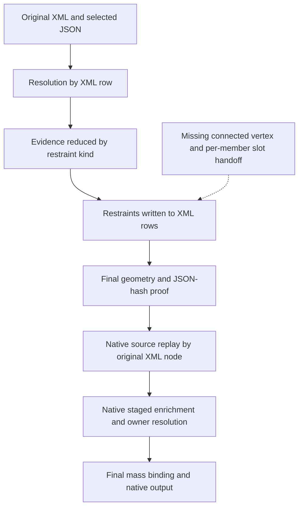

# XML229 native ownership — current-main handoff trace

Owner direction: “ignore PR, proceed next.” Scope: the existing main path only, read-only source analysis; no production edits. Primary plan: [native ownership WBS](xml229-native-ownership-wbs-20261102.md). Source: `5c39dd7bdbb7f2f63a686823b72bdb81909d52af`, confirmed live main on 02 November 2026. [Eight-file identity and finding record](../../agents/evidence/xml229-native-handoff-trace-20261102.json).

## Finding

**The first missing handoff is before Final, where original source restraints are materialized into XML.** The current entry receives original XML, staged JSON and configuration, then resolves and writes by XML row. It does not consume a connected physical-vertex map with an occurrence-identified list of nodal members and their canonical output attachment. The existing CII writer's six-slot capacity is a downstream capability; it cannot reconstruct source members already collapsed or attached incorrectly upstream.

This is established by static source inspection, not by reproducing the unavailable private run or a new converter execution. It does not prove that every reported ambiguity is a false physical-node ambiguity.

## Verified path at the pinned source

| Stage | Source location | Observed behavior |
| --- | --- | --- |
| Producer | `xml229-preview-engineering-fact-producer.mjs:102–108` | Calls `prepareXml229PrefinalRestraints` before source cleanup, passing XML, staged source and work config. |
| Prefinal entry | `integration/xml229-prefinal-restraints.mjs:24–36` | Calls row-based closure with `requireUnambiguous:true`; protects all non-restraint source fields. Its `PrefinalRestraints.v1` proof contains schema and original JSON SHA. Other packet/source/config checks remain in force elsewhere. |
| Source resolution | `xml-cii-trace-resolution-ledger.js:593–603` | Builds source position groups, then creates one resolution record for each XML node. Records use XML index, node number, branch and component ref (`:464–527`). |
| Evidence reduction | `xml-cii-mds-restraint-closure.js:250–301` | `Map` stores one selected attributes object per support kind. Distinct same-kind source occurrences cannot all survive this representation; some differences cause conflicts rather than separate slots. Hardware-selection rules also exist and must remain distinct from member identity. |
| XML materialization | Same closure, `:357–427` | Looks up each node by XML row index, rejects ambiguous row records, then appends generated restraints. Existing-type filtering (`:403–423`) can suppress another member based on type alone. |
| Final snapshot | Producer `:292–296` | Passes the prefinal proof into geometry finalization. No physical-vertex/member-slot map is returned by the inspected prefinal entry. |
| Native source replay | `xml229_prefinal_restraints.py:296–337`; `xml229_native_final_mass_binding.py:386–412` | Checks the JSON SHA and rebuilds expected restraints by original XML node, then compares complete source-derived XML with the Final snapshot after allowed numbering/rigid normalization. |
| Native enrichment | `xml_to_cii2019_runtime_custody.py:417–447`; `xml_to_cii2019_patched.py:1548–1651` | After original lineage staging, invokes staged enrichment again. The addon resolves mandatory owners; ambiguous/unmatched cases fail closed. Final mass binding follows. |
| Exact output artifact | Runtime custody `:450` | Exports the actual enriched converter input. This does not itself establish that its ownership/member choices match the original physical graph. |

## Smallest coherent repair boundary

The repair needs a qualified source identity/transfer contract across the materializer and native checker. Changing a tolerance or the serializer alone cannot repair these upstream representations.

1. **Before materialization:** reconstruct original connected physical vertices from qualified source topology and exact coordinates, retaining every branch/node occurrence and original position. Same XYZ with disconnected topology remains separate; repeated `-1` is not global identity.
2. **Preserve members:** retain each independently authorized JSON member occurrence through the saved Step 7/8 rules and its own gap, stiffness, friction and direction. Select hardware/classification evidence explicitly; do not use kind/type equality as member identity. Reconcile authored XML restraints separately.
3. **Materialize once:** bind the ordered 1–6 member set to one canonical native representation of the physical vertex before Final acceptance. Preserve source occurrence/alias lineage. Any required numbering/geometry contract change must be reviewed before accepted Final; a genuine interior split is a separate new vertex with qualified coordinates.
4. **Verify at native entry:** independently check original-source vertex membership, member conservation and the bound Final map. Native consumption must use the verified attachment result rather than perform another ownership selection. Preserve the complete source comparison, stale-basis checks, existing mass authority and failure guards.

The initial implementation package is an immutable original-occurrence/connected-vertex model with independent benchmark expectations. The materializer/native integration follows after that model is qualified. This document does not authorize implementation or a schema/Final contract cutover.

## Independent expectations for the next package

Use the already saved [benchmark observations](xml229-benchmark-three-problem-wbs-20261102.md), without substituting them for the unavailable exact private run.

- EF-05 50/60 and BM2 20/30: classify the actual connected station and preserve every occurrence, source coordinate and authored restraint. Include a disconnected same-XYZ counterexample.
- OLET `-1/70/-1`: preserve endpoint/center roles and port geometry; numbering must not erase physical incidence.
- EF enriched node 90: two members, `+Y/GUI`, gaps `0/6`. Node 160: three members, `+Y/GUI/LIM`, gaps `0/20/20`. These are literal historical artifacts; complete engineering acceptance is separate.
- Independently authorized repeated-kind members: verify that differing direction/gap/source occurrence survives to distinct slots; define the expected result before invoking production code.
- Six occupied CII slots survive; a seventh required entry has an explicit capacity outcome. Preserve configured mutation and apply it once.
- Before/after rigid preparation: retained source XYZ and physical component mass ownership remain correct; second vertex/member and existing weight passes occur before Final acceptance.

## Validation and next action

| STATUS | OBSERVATION | ORACLE |
| --- | --- | --- |
| PASS | Eight inspected source files matched their pinned Git blobs; call sites, row indexing, kind/type reduction and native replay/enrichment were read directly. | Byte identity plus static control-flow inspection; no converter-generated expectation. |
| NOT_RUN | New runtime counterexample, exact private claim census, repaired output, independent actual-CII acceptance. | Required subsequent source-qualified execution; no success inferred from this trace. |

Next: qualify original connected-vertex identity and per-member expected results on the public cases, then select the minimal coordinated producer/materializer/native patch. Keep the current source/Final/mass checks and no post-Final geometry mutation. No PR investigation or production editing occurred in this routine.
